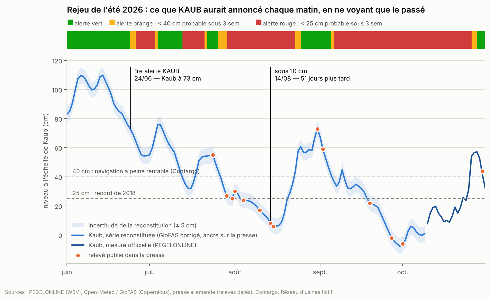

# KAUB — un agent d'IA pour protéger la marge des amidonneries face aux basses eaux du Rhin

KAUB lit chaque matin le niveau du Rhin, sa prévision à six semaines et les prix du blé, du gaz et du carbone, puis propose à une équipe d'approvisionnement deux ou trois actions chiffrées pour un réseau **fictif** de trois usines d'amidon. Le nom vient de Kaub, la station de mesure qui sert de référence à la navigation sur le Rhin moyen.

> **Règle de conception : le modèle d'IA orchestre, le code calcule, l'humain décide.** Aucun chiffre n'est produit par le modèle d'IA : chacun sort d'une fonction testée, et un vérificateur contrôle que chaque nombre de la note figure bien dans les résultats des calculs.

Prototype personnel, construit à partir de données publiques. Les niveaux, prévisions et prix sont **réels** ; le réseau d'usines, ses stocks et ses coûts sont **fictifs**, inspirés de cas publics, et ne décrivent les opérations d'aucune entreprise.



## Ce que KAUB a produit sur des données réelles

**Le 9 novembre 2026** (instantané rangé dans `data/reference/`), Kaub était à 11 cm. Extrait de la note du matin ([note complète](sorties/notes/note_2026-11-09.md)) :

- chenal profond de 124 cm : le bateau type charge 14 % de sa capacité, il faut 7,1 bateaux pour en remplacer un, le fret vaut 4,78 fois son niveau normal ;
- usine A (70 % par péniche) en alerte rouge : 15,8 jours d'autonomie au niveau actuel, rupture dans 100 % des 50 scénarios si rien ne change ;
- proposition : basculer 30 % des volumes sur le rail et appeler des camions d'appoint, ce qui ramène le risque de rupture à 0 % pour une économie moyenne de 310 k€ sur six semaines par rapport à ne rien faire (pénalités de rupture comprises), à valider par le responsable logistique.

**Rejeu de l'été 2026** ([rapport complet](sorties/rejeu/rapport_rejeu.md)) : en ne regardant chaque jour que le passé, KAUB serait passé en alerte le 24 juin, quand Kaub était encore à 73 cm, soit **51 jours avant que le fleuve passe sous 10 cm** (14 août) ; il serait passé en alerte rouge le 26 juin, 38 jours avant que le record de 2018 (25 cm) ne tombe. Le 24 juin, il aurait proposé le rail et les camions d'appoint ; sur les niveaux réellement observés ensuite, cette option évitait 8 083 t de production perdue et coûtait 536 k€ de moins que ne rien faire.

## Installation

Python 3.10 ou plus récent.

```bash
git clone <adresse du dépôt> kaub && cd kaub
python -m venv .venv && source .venv/bin/activate      # Windows : .venv\Scripts\activate
pip install -e ".[dev]"
python -m pytest -q                                     # 39 tests, sans réseau ni clé
```

Pour l'agent (facultatif) : copier `.env.example` en `.env` et y mettre une clé d'API Anthropic (interface de programmation de Claude, sur https://platform.claude.com). Sans clé, tout fonctionne sauf la rédaction et les questions par Claude.

## Utilisation

| Commande | Ce qu'elle fait |
|---|---|
| `python -m kaub note --hors-ligne` | Note du matin sur les données réelles du 9 novembre 2026, sans connexion |
| `python -m kaub note` | Note du matin sur les données du jour (rédigée par le gabarit) |
| `python -m kaub note --ia` | Note du matin rédigée par Claude, avec contrôle de chaque chiffre |
| `python -m kaub question "Combien de jours d'autonomie pour l'usine A si le Rhin est impraticable dix jours ?"` | Question libre à l'agent |
| `python -m kaub rejeu` | Reconstitution de l'été 2026 et rejeu jour par jour |
| `streamlit run app/tableau_de_bord.py` | Tableau de bord (note, Rhin, usines, rejeu, questions, hypothèses) |
| `python -m kaub decider --date 2026-11-09 --usine A --option "…" --par "Prénom" [--ecartee] --commentaire "…"` | Enregistrer la décision de l'équipe : KAUB en tient compte ensuite |
| `python scripts/construire_excel.py` | Version Excel du modèle de coût (`excel/modele_cout_kaub.xlsx`) |

Les sorties vont dans `sorties/` (notes, analyses, alertes et brouillons de messages, rejeu). **Rien n'est jamais envoyé** : les alertes et les messages à l'équipe logistique sont déposés sous forme de fichiers à relire.

## Comment ça marche

```
 Données publiques                 Code testé (calcule)                        Agent (orchestre)              Humain
 ─────────────────                 ────────────────────                        ─────────────────              ──────
 PEGELONLINE : niveaux  ─┐   courbe de tarage, correction GloFAS ─┐
 GloFAS : 50 scénarios  ─┼─▶ scénarios de niveau sur 6 semaines   ├─▶ 10 outils ─▶ Claude choisit les   ─▶ décide,
 Open-Meteo : pluie     ─┤   navigation → capacité → fret         │               calculs, rédige la      journal des
 Euronext, Yahoo : prix ─┘   stock jour par jour, marge, options ─┘               note ─▶ vérificateur     décisions
```

1. **Du niveau à la capacité des péniches.** Profondeur du chenal = TuGlW − GlW + niveau (TuGlW : profondeur garantie quand l'eau est au niveau d'étiage de référence GlW ; formule et pied de pilote de 20 cm : Contargo). On en déduit le tirant d'eau possible, la charge utile du bateau type et le taux de chargement.
2. **Du taux de chargement au fret.** Multiplicateur du fret = taux de chargement ^ (−0,8), plafonné à 6, calé pour reproduire le « fret multiplié par 3 à 4 » relevé par la presse quand Kaub était vers 25 cm.
3. **La prévision.** Les 50 scénarios de débit de GloFAS (Global Flood Awareness System, modèle hydrologique du programme européen Copernicus) sont corrigés de leur biais, convertis en niveaux par la courbe de tarage, puis recollés au niveau mesuré du jour.
4. **Le stock et les options.** Pour chaque scénario et chaque option (ne rien changer, avancer des péniches, basculer sur le rail, camions d'appoint, combinaisons), le stock est simulé jour par jour sur six semaines, avec les délais et les capacités de chaque mode. On obtient le coût moyen, le risque de rupture et les tonnes perdues. Règle de recommandation : l'option la moins chère parmi celles qui gardent le risque de rupture sous 10 %.
5. **L'agent.** Claude dispose de dix outils (lire les niveaux, la prévision, les prix ; chiffrer un coût rendu, une couverture, une marge ; comparer les options ; relire les décisions passées ; déposer une alerte ; préparer un brouillon). Il choisit lesquels appeler, enchaîne les étapes et rédige. Le **vérificateur** relève ensuite chaque nombre de son texte et le cherche dans les résultats des outils.

## Données et licences

| Donnée | Source | Accès |
|---|---|---|
| Niveaux et débits du Rhin (Kaub, Duisburg-Ruhrort) | PEGELONLINE, administration fédérale allemande des voies navigables (WSV) | Interface gratuite, licence CC BY 4.0 (réutilisation libre en citant la source), 31 jours d'historique |
| Débits simulés et prévision d'ensemble (50 scénarios) | GloFAS (Copernicus), via Open-Meteo | Gratuit pour un usage non commercial, CC BY 4.0 |
| Pluie prévue sur le bassin | Open-Meteo | Idem |
| Blé et maïs | Euronext (pages publiques, cours différés) | Saisie manuelle dans `data/historique/prix_manuels.csv` |
| Gaz TTF, quota carbone (approximation par un titre adossé à des quotas) | Yahoo Finance (cours différés) | Usage personnel ; conditions à vérifier avant tout usage professionnel |
| Valeurs caractéristiques des stations | PEGELONLINE ; annuaire hydrologique de l'Institut fédéral d'hydrologie (BfG) | Public |
| Règles de chargement selon le niveau | Contargo, brochure sur les basses eaux (2017) | Public |
| Relevés de l'été 2026 | Presse allemande datée (liste et liens dans `data/reference/releves_presse_2026.csv`) | Public |

Comme PEGELONLINE efface ses données après un mois, le workflow GitHub `collecte.yml` enregistre niveaux et prix quatre fois par jour dans `data/historique/` (gratuit sur les serveurs de GitHub).

## Ce qui a été vérifié

- **39 tests automatiques** (`tests/`), lancés à chaque modification par GitHub Actions : formules de navigation, courbe de tarage, absence de regard vers l'avenir dans le rejeu, bilan matière de la simulation, vérificateur de chiffres, boucle complète de l'agent contre une API simulée, mode en ligne contre un réseau simulé.
- **Le modèle face aux faits publiés** : à 8 cm, chenal de 121 cm (le service des voies navigables annonçait « un peu plus de 1,20 m » le 14 août 2026) ; à 150 cm, chargement de 82 % (« la plupart des bateaux chargent à plein vers 150 cm ») ; vers 25 cm, chargement de 21 % (la presse parlait d'un tiers à la moitié de la charge, ou d'un cinquième sur le Rhin inférieur).
- **La courbe de tarage** reproduit les 30 jours de mesures officielles à 1 m³/s près et passe par les valeurs de l'annuaire hydrologique (79 cm pour 784 m³/s, 498 cm pour 3 720 m³/s).
- **La série de l'été** : validation croisée sur 12 relevés de presse, erreur moyenne de 5,4 cm (maximum 17,3 cm) ; le minimum d'août (6 cm le 16 août) est retrouvé sans avoir utilisé ce relevé.
- **Le classeur Excel** reproduit les calculs Python (feuille « Contrôle »).

## Limites connues

- Réseau d'usines, stocks, coûts de transport, valeur des produits et pénalités de rupture : **hypothèses**, toutes dans `config/hypotheses.yaml`. La valeur des produits (380 €/t de blé) et le fret fluvial de base sont les deux hypothèses les plus fragiles : à faire valider par un professionnel.
- Un seul bateau type ; le modèle est prudent par eaux extrêmement basses (à −6 cm il prévoit 6 % de chargement, alors qu'un affréteur a fait passer 21 % de la charge habituelle avec des bateaux plus petits).
- La série de l'été 2026 est reconstituée ; avant le 24 juillet, aucun relevé ne l'ancre (incertitude de l'ordre de 15 cm).
- Le rejeu utilise une prévision de tarissement (sans pluie), plus simple que la prévision d'ensemble du quotidien.
- Le prix du quota carbone est une approximation ; les prix Euronext se saisissent à la main.

## Organisation du code

```
config/hypotheses.yaml      toutes les hypothèses, avec leur source
kaub/hydro/                 courbe de tarage, correction de GloFAS, prévisions, reconstitution de l'été
kaub/modele/                navigation, coûts rendus, marge, simulation du stock, options
kaub/sources/               PEGELONLINE, Open-Meteo, prix, archivage
kaub/agent/                 outils de Claude, boucle d'agent, vérificateur de chiffres
kaub/situation.py           données du jour (en ligne ou instantané du 9/11/2026)
kaub/analyse.py             tous les calculs du jour en un dictionnaire
kaub/note.py                note du matin (gabarit)
kaub/rejeu.py               rejeu de l'été 2026
app/tableau_de_bord.py      tableau de bord Streamlit
data/reference/             instantané réel du 9 novembre 2026 et relevés de l'été
tests/                      tests automatiques
```
